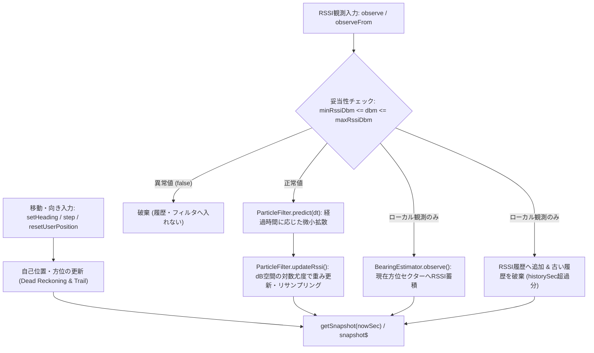

# Superfind Radar Core (Angular v13 / TypeScript)

元の Rust 実装 (`crates/superfind-core`) のレーダー推定アルゴリズムから**計算の本質だけ**を抽出し、**RFID / BLE 両対応**でシンプルに再構築した Angular v13 (TypeScript) プロジェクトです。

このドキュメントでは、以下を実装コードと対応づけて解説します。
1. フォルダ構成と役割分担
2. 全体の処理手順（観測からスナップショット出力までの流れ）
3. 数学的処理の詳細（数式・アルゴリズムの根拠）
4. 実装・運用上の注意点（特に **RFID 対応と Bluetooth 専用要素の違い**）
5. 使い方とテスト方法

---

## 1. フォルダ構成

計算コアは `src/app/radar/` 配下の **5ファイル** に集約しています。

```text
radar-app/
├── package.json                      # Angular v13.3 / TypeScript ~4.6
├── angular.json / tsconfig.json
└── src/app/radar/
    ├── radar.models.ts               # 型定義・Snapshot・無線プロファイル (RFID / BLE)
    ├── radar-math.ts                 # 座標変換・パスロスモデル・校正・95%信頼楕円・PRNG
    ├── bearing-estimator.ts          # 合成開口（セクター別RSSI）方位推定
    ├── particle-filter.ts            # 2Dパーティクルフィルタ（位置・信頼楕円・発散検知）
    ├── radar-tracker.service.ts      # Angular @Injectable ファサード（状態統合・履歴・トレンド）
    ├── index.ts                      # バレルエクスポート
    └── radar.spec.ts                 # 数学的性質とRFID/BLEシナリオの単体テスト
```

---

## 2. 全体の処理手順

### 2.1 データフロー全体像



### 2.2 1観測あたりのステップバイステップ手順

`RadarTrackerService` を利用するときの標準的な処理手順は以下の通りです。

1. **初期化（プロファイル選択）**
   - `configure(RFID_UHF_PROFILE)` または `configure(BLE_PROFILE)` を呼ぶ。
   - 現場で事前測定できる場合は `fitPathLoss(samples)` でキャリブレーションし、`isPathLossPlausible()` と `pathLossResidualRms() <= 8 dB` を確認した上で `setPathLoss()` で反映する。
2. **姿勢・移動の更新（随時）**
   - コンパスやリーダーの向きが変わったら `setHeading(headingRad, t)` を呼ぶ。
   - 歩数検知や移動イベントで `step(t, lengthM?)`、または既知座標がある場合は `resetUserPosition(pos, t)` を呼ぶ。
3. **RSSI観測の投入（タグ／デバイスを受信するたび）**
   - 自端末・ハンディリーダーで受信したら `observe({ dbm, timestampSec })` を呼ぶ。
   - 別の固定RFIDリーダーや他端末から届いた観測は `observeFrom(obs, readerPos, false)` を呼ぶ（自端末の表示RSSIやセクター方位を汚さず、パーティクルフィルタの位置絞り込みだけに参加する）。
4. **内部での並列更新**
   - **異常値除外**: プロファイルの `[minRssiDbm, maxRssiDbm]` 外と非有限値を弾く。
   - **時間予測 (`predict`)**: 前回観測からの経過時間 $\Delta t > 0$ に応じて粒子を微小拡散する。
   - **位置フィルタ更新 (`updateRssi`)**: 全粒子の対数重みを更新し、発散判定と必要に応じたリサンプリングを行う。
   - **方位セクター更新 (`BearingEstimator.observe`)**: ローカル観測時のみ、現在の方位セクターへ加算する。
   - **履歴更新 (`history`)**: ローカル観測時のみ蓄積し、`historySec` より古いサンプルを削除する。
5. **スナップショットの生成 (`getSnapshot(nowSec)`)**
   - すべての算出値（中央値RSSI、鮮度、粗い距離、トレンド、近接クリック指標、方位推定、2D位置・95%信頼楕円、セクター平均）を**同一時刻の1つの不変オブジェクト `RadarSnapshot`** にまとめて返す。
   - UI や音・振動フィードバックは必ずこの同一スナップショットを参照する（数値・矢印・音が食い違わないようにするため）。

---

## 3. 数学的処理の詳細

### 3.1 座標系とコンパス方位（`radar-math.ts`）

ローカル ENU（East-North-Up）平面座標を使用します。

- $+x$: 東 [m]、$+y$: 北 [m]
- コンパス方位 $\theta$: **北を $0$ として時計回りを正**（東 $=\frac{\pi}{2}$、南 $=\pi$、西 $=-\frac{\pi}{2}$）

2点 $A=(x_a, y_a)$ から $B=(x_b, y_b)$ への距離・方位、および移動後の座標は以下で計算します。

$$
d(A, B) = \sqrt{(x_b - x_a)^2 + (y_b - y_a)^2}
$$

$$
\theta(A \to B) = \operatorname{wrap}_{(-\pi, \pi]}\!\left(\operatorname{atan2}(x_b - x_a,\ y_b - y_a)\right)
$$

$$
\text{offset}(A, \theta, d) = \left(x_a + d\sin\theta,\ y_a + d\cos\theta\right)
$$

> **注意**: 通常の数学座標（東=0, 反時計回り）と $\sin / \cos$ および $\operatorname{atan2}$ の引数順が逆です。角度計算を `radar-math.ts` に閉じ込めることで符号ミスを防いでいます。

---

### 3.2 対数距離パスロスモデルと「dB空間」尤度（`radar-math.ts`）

距離 $d$ [m] における期待 RSSI は、近傍界クランプ $d_{\min} = 0.25\,\text{m}$ を用いて次式で定義します。

$$
\hat{r}(d) = P_{1\text{m}} - 10\,n\,\log_{10}\!\bigl(\max(d,\ d_{\min})\bigr)
$$

- $P_{1\text{m}}$ (`txPower1m`): 1m 地点での期待 RSSI [dBm]
- $n$ (`exponent`): パスロス指数（自由空間 $2.0$、屋内BLE $\approx 2.8$、パッシブUHF RFID往復減衰 $\approx 3.6$）

逆変換による単一観測からの粗い距離推定（**表示・初期粒子生成専用**）は次式です。

$$
\hat{d}(r) = \max\!\left(10^{\frac{P_{1\text{m}} - r}{10\,n}},\ d_{\min}\right)
$$

#### 対数尤度（フィルタ更新の核心）

電波のシャドーイング誤差は距離[m]ではなく **dB空間で正規分布 $\mathcal{N}(0, \sigma_{\text{dB}}^2)$** に従います。そのため、候補距離 $d$ に対する観測値 $r$ の対数尤度は必ず dB 空間で評価します。

$$
\log p(r \mid d) = -\frac{1}{2}\left(\frac{r - \hat{r}(d)}{\sigma_{\text{dB}}}\right)^2 - \ln\sigma_{\text{dB}} - \frac{1}{2}\ln(2\pi)
$$

> **なぜ距離空間で評価してはいけないのか**: $d$ は RSSI に対して指数関数的に変化するため、dB を先にメートルへ変換してガウス誤差を当てると、遠距離側の候補粒子が不当に大きく罰せられ、推定位置が手前側に強く歪みます。

#### 最小二乗キャリブレーション（`fitPathLoss` / `pathLossResidualRms`）

実測ペア $(d_i, r_i)$ に対し $x_i = \log_{10}(d_i)$、$y_i = r_i$ と置くと、パスロス式は線形回帰 $y = a + b x$（切片 $a = P_{1\text{m}}$、傾き $b = -10n$）になります。

$$
b = \frac{\sum (x_i - \bar{x})(y_i - \bar{y})}{\sum (x_i - \bar{x})^2}, \qquad
P_{1\text{m}} = \bar{y} - b\bar{x}, \qquad
n = \max\!\left(-\frac{b}{10},\ 1.5\right)
$$

校正の品質は RMS 残差で評価します。

$$
\text{RMS} = \sqrt{\frac{1}{M}\sum_{i=1}^{M}\bigl(r_i - \hat{r}(d_i)\bigr)^2}
$$

- 目安: 良好な屋内環境で **3〜5 dB**。**8 dB 超** や物理範囲外（`txPower1m ∉ [-100, -15]`、`exponent ∉ [1.5, 6.0]`）のフィットは採用せずデフォルト値へ戻します。
- 距離は $1\text{m}, 2\text{m}, 4\text{m}, 8\text{m}$ のように**等比間隔（倍々）**で測ると $\log_{10}(d)$ 軸上で等間隔になり回帰精度が安定します。

---

### 3.3 合成開口（Synthetic Aperture）方位推定（`bearing-estimator.ts`）

360°を $K$ 個のセクター（デフォルト $K=16$、1セクター $22.5^\circ$）に分割します。

$$
\text{sector}(\theta) = \left\lfloor \frac{\operatorname{wrap}_{[0, 2\pi)}(\theta)}{2\pi / K} \right\rfloor, \qquad
\theta_k = \operatorname{wrap}_{(-\pi, \pi]}\!\left((k + 0.5)\frac{2\pi}{K}\right)
$$

観測済みセクター集合を $\mathcal{F}$（要素数 $|\mathcal{F}| \ge 2$ が必須）、各セクターの平均RSSIを $\mu_k$、全体平均を $\bar{\mu} = \frac{1}{|\mathcal{F}|}\sum_{k \in \mathcal{F}} \mu_k$ とします。

1. **超過信号による円加重平均（隣接セクターの滑らかな補間）**
   全体平均より強いセクターだけを超過量 $e_k = \max(\mu_k - \bar{\mu}, 0)$ で重み付けします。

   $$
   S = \sum_{k \in \mathcal{F}} e_k \sin\theta_k, \qquad
   C = \sum_{k \in \mathcal{F}} e_k \cos\theta_k, \qquad
   W = \sum_{k \in \mathcal{F}} e_k
   $$

   $$
   \hat{\theta} = \operatorname{wrap}_{(-\pi, \pi]}\!\bigl(\operatorname{atan2}(S, C)\bigr)
   $$

2. **3要素の積による信頼度（`confidence`）**
   以下の3つが**すべて**揃ったときだけ高い信頼度を返します（平均ではなく**積**にするのが設計上の要点です）。

   - **カバレッジ（網羅率）**:
     $$
     c_{\text{cov}} = \frac{|\mathcal{F}|}{K}
     $$
   - **集中度（円統計の合成ベクトル長 / Resultant length）**:
     $$
     R = \operatorname{clamp}_{[0,1]}\!\left(\frac{\sqrt{S^2 + C^2}}{W}\right)
     $$
     超過信号が1方向に集まっていれば $R \to 1$、全方位均一や反対側2方向に割れていれば $R \to 0$。
   - **統計的有意性（ピーク対ノイズ比）**:
     コントラスト $\Delta = \max_{k \in \mathcal{F}} \mu_k - \bar{\mu}$、1セクター平均サンプル数 $\bar{m} = \max(N_{\text{total}} / |\mathcal{F}|, 1)$、標準誤差 $\text{SE} = \sigma_{\text{noise}} / \sqrt{\bar{m}}$ として
     $$
     c_{\text{sig}} = \operatorname{clamp}_{[0,1]}\!\left(\frac{\Delta}{2\,\text{SE}}\right)
     $$
   - **総合信頼度**:
     $$
     \text{confidence} = c_{\text{cov}} \cdot R \cdot c_{\text{sig}}
     $$
     （UI で矢印を表示する目安は `confidence >= 0.30`、それ未満は未確定としてスキャン継続を促す）

3. **角度不確実性（円標準偏差 $\sigma_\theta$）**
   ビン分割幅より細かい精度を主張しないよう、半セクター幅を下限とします。

   $$
   \sigma_\theta = \max\!\left(\sqrt{-2\ln\!\bigl(\operatorname{clamp}_{[10^{-6}, 1]}(R)\bigr)},\ \frac{\pi}{K}\right)
   $$

---

### 3.4 2Dパーティクルフィルタ（`particle-filter.ts`）

状態はターゲットの平面位置 $\mathbf{p}_i = (x_i, y_i)$（$i = 1, \dots, N$、デフォルト $N=512$）と対数重み $\ell_i$ です。ターゲットは基本的に静止していると仮定し、観測者（ユーザー／リーダー）の移動によって位置を絞り込みます。

#### (1) 初期化と初回観測の円環サンプリング

- リセット時は面積に対して一様な円盤に散布します（$r = R_{\text{init}}\sqrt{u}$。$\sqrt{u}$ を掛けないと中心に密集するバイアスが生じるため必須）。
- **初回観測 (`observations === 0`)**: 広い一様円盤をそのまま重み付けすると有効粒子が数個しか残らず偏るため、初回観測だけは「観測RSSIに整合する円環」から直接 $N$ 個サンプリングします。
  $$
  r_i \sim \mathcal{N}(r_{\text{obs}}, \sigma_{\text{dB}}^2), \quad
  d_i = \hat{d}(r_i), \quad
  \phi_i \sim \mathcal{U}(0, 2\pi), \quad
  \mathbf{p}_i = \text{offset}(\mathbf{u}, \phi_i, d_i)
  $$

#### (2) 予測ステップ（`predict(dt)`）

自己位置誤差やわずかな移動を吸収するため、経過時間 $\Delta t$ に比例したガウス拡散を加えます（デフォルト $\sigma_v = 0.05\,\text{m/s}$）。

$$
\mathbf{p}_i \leftarrow \mathbf{p}_i + \mathcal{N}\!\bigl(\mathbf{0},\ (\sigma_v \Delta t)^2 \mathbf{I}\bigr)
$$

#### (3) 重み更新と log-sum-exp 正規化（`updateRssi`）

観測者位置 $\mathbf{u}$ での観測値 $r$ に対し、各粒子の対数重みを加算します。

$$
\ell_i \leftarrow \ell_i + \log p\!\left(r \mid d(\mathbf{u}, \mathbf{p}_i)\right)
$$

生の確率密度を掛け算すると数百回で `0` にアンダーフローするため、必ず対数空間で保持し、正規化時は最大値 $\ell_{\max} = \max_i \ell_i$ を引いて指数化します（**log-sum-exp トリック**）。

$$
\tilde{w}_i = \exp(\ell_i - \ell_{\max}), \qquad
w_i = \frac{\tilde{w}_i}{\sum_{j=1}^N \tilde{w}_j}
$$

#### (4) 発散検知（`diverged`）

各観測で全粒子のうち最も当てはまりの良い標準化残差 $z_{\min} = \min_i \left|\frac{r - \hat{r}(d(\mathbf{u}, \mathbf{p}_i))}{\sigma_{\text{dB}}}\right|$ を記録します。

- $z_{\min} > 6.0$ が **8回連続**した場合、または正規化重みの総和が非有限・0以下になった場合、`diverged = true` を立てます（モデルと現実が乖離しているためリセットを促す）。

#### (5) リサンプリング・Roughening・Rejuvenation

有効サンプルサイズ比（Effective Sample Size fraction）を算出します。

$$
\text{ESS}_{\text{frac}} = \frac{1}{N \sum_{i=1}^{N} w_i^2} \in (0, 1]
$$

- $\text{ESS}_{\text{frac}} < 0.5$: $O(N)$ で低分散な **Systematic Resampling** を実行し、全粒子が同一点に潰れる（粒子退化）のを防ぐためジッター $\mathcal{N}(0, 0.15^2\,\text{m}^2)$ を付加（**Roughening**）して対数重みを `0` に戻します。
- $\text{ESS}_{\text{frac}} < 0.05$: リサンプリングだけでは多様性を回復できないため、ランダムに選んだ **30%** の粒子を最新観測から生成した新粒子で置換します（**Rejuvenation**）。

#### (6) 推定位置・95%信頼楕円・信頼度（`getFix`）

観測数が0の場合は事前分布を返さず `null` を返します。

1. **重み付き平均と 2×2 共分散行列**:
   $$
   \boldsymbol{\mu} = \sum_{i=1}^N w_i \mathbf{p}_i, \qquad
   \boldsymbol{\Sigma} = \begin{pmatrix} \Sigma_{xx} & \Sigma_{xy} \\ \Sigma_{xy} & \Sigma_{yy} \end{pmatrix}
   = \sum_{i=1}^N w_i (\mathbf{p}_i - \boldsymbol{\mu})(\mathbf{p}_i - \boldsymbol{\mu})^\top
   $$
2. **固有値分解による 95%信頼楕円（`covarianceToEllipse`）**:
   2×2 対称行列の固有値 $\lambda_1 \ge \lambda_2 \ge 0$ を閉形式で解き、自由度2のカイ二乗分布 95%点 $\chi^2_{2, 0.95} \approx 5.99146$ を掛けて長半径・短半径を得ます。
   $$
   \lambda_{1,2} = \frac{\Sigma_{xx} + \Sigma_{yy}}{2} \pm \sqrt{\left(\frac{\Sigma_{xx} + \Sigma_{yy}}{2}\right)^2 - (\Sigma_{xx}\Sigma_{yy} - \Sigma_{xy}^2)}
   $$
   $$
   a = \sqrt{5.99146\,\lambda_1}, \qquad b = \sqrt{5.99146\,\lambda_2}
   $$
3. **方位の円標準偏差と位置信頼度**:
   $$
   \text{confidence} = \frac{1}{1 + \frac{a}{\max(d(\mathbf{u}, \boldsymbol{\mu}),\ 1.0)}}
   $$
   距離 $20\text{m}$ で誤差半径 $15\text{m}$ と、距離 $2\text{m}$ で誤差半径 $0.5\text{m}$ の違いを単一指標で表します。

---

### 3.5 RSSI中央値・トレンド・近接フィードバック（`radar-tracker.service.ts`）

1. **高優先度ソース優先＋中央値フィルタ (`medianOfBestPriority`)**
   - 直近 `liveWindowSec`（デフォルト 4秒）内のサンプルから、`priority` が最小（最高信頼）のソースだけを抽出し、その**中央値 (median)** を代表 RSSI とします。
   - **理由**: マルチパスによる一瞬のスパイク（例: -70 dBm の列に混ざる -20 dBm）を平均は引きずりますが、中央値は完全に無視します。また、低品質・高頻度ソースが少数決で高品質ソースを押し潰すバグを防ぎます。
2. **トレンド判定 (`computeTrend`)**
   - 直近ウィンドウ（$0 \sim 4\text{s}$）の中央値と過去ウィンドウ（$4 \sim 12\text{s}$）の中央値を比較（双方2サンプル以上必要）。
   - 差が $+3.0\,\text{dB}$ 超なら `warmer`、$-3.0\,\text{dB}$ 未満なら `colder`、それ以外は `steady`。
3. **ガイガーカウンター指標（幾何補間 `computeProximityCue`）**
   - `isFresh === false`（最終受信から `freshnessSec` 超過）のとき**のみ `null`（無音）**。
   - 強度 $t = \operatorname{clamp}_{[0,1]}\!\left(\frac{r - r_{\text{far}}}{r_{\text{near}} - r_{\text{far}}}\right)$ を用い、人間の聴覚に合わせて**幾何補間**でクリック間隔と音程を決定します。
     $$
     \text{intervalMs} = 1400 \cdot \left(\frac{70}{1400}\right)^t, \qquad
     \text{pitchHz} = 440 \cdot \left(\frac{1320}{440}\right)^t
     $$
   - 最速間隔は `70 ms`（60 ms 未満になるとクリックが連続音に潰れてリズム情報が失われるため）。

---

## 4. 実装・運用上の注意点（特に RFID 対応と BLE 専用要素）

### 4.1 Bluetooth (BLE) 専用機能と RFID 対応の比較

| 観点 | Bluetooth (BLE) の特性・制約 | RFID (UHF 920MHz等) での注意点・本実装での対応 |
|---|---|---|
| **観測ソース種別** | GATT接続 `readRSSI` / パッシブアドバタイズ / Classic Poll が混在する | RFID には GATT 接続もアドバタイズも無く、インベントリ読取 (`EPC + RSSI`) が基本。BLE専用列挙型を廃止し、`RssiObservation` を `{ dbm, timestampSec, sigmaDb?, priority? }` に統一 |
| **電波減衰 (Path Loss)** | 2.4GHz 片道伝搬（`txPower1m ≈ -59`, `n ≈ 2.8`, レンジ最大数十m） | パッシブ UHF RFID は **リーダー→タグ→リーダーの往復減衰（バックスキャッタ）** のため距離減衰が急（`txPower1m ≈ -50`, `n ≈ 3.6`, レンジ数m〜10m）。`RFID_UHF_PROFILE` を標準プリセットにし、`fitPathLoss()` で実タグ校正が可能 |
| **方位推定の物理原理** | スマホは無指向性アンテナのため、**人体遮蔽 (5〜15 dB)** を使ってその場で回転する必要がある | ハンディ RFID リーダーは**指向性アンテナ（ビーム幅 60°〜120°程度）**を持つことが多く、タグ方向に向けたときのコントラストが大きいため `BearingEstimator` と非常に相性が良い |
| **異常値・欠損値** | BLE HCI は `-127 dBm` を未測定センチネルとして返す | リーダーSDKによって異常値仕様が異なるため、固定値ハードコードを廃止し `RadioProfile.minRssiDbm / maxRssiDbm` で弾く設計にした |
| **測距・角度API** | Android 16 Ranging API（UWB / BLE Channel Sounding / Wi-Fi RTT）や UWB AoA が使える場合がある | 一般的な RFID リーダーには存在しないためコアから切り離した（将来距離センサを併用したい場合のみ `ParticleFilter.updateRange()` を呼べる） |
| **BLE周辺機能** | MACアドレスローテーション・DULTストーカー検知・Service UUID解析・気圧計フロア判定 | レーダー計算の本質ではなく BLE 依存のため削除 |
| **複数観測点の連携** | 複数スマホ間の座標合わせが難しい | 倉庫・店舗の**固定RFIDリーダー（天井・ゲート）**は既知座標を持つため、`observeFrom(obs, readerPos)` で三辺測量のように即座に高精度化できる |

### 4.2 レーダーアルゴリズム共通の重要な落とし穴

1. **「直線歩行」だけでは位置は一意に決まらない（鏡像曖昧性）**
   - 一直線上の各地点から測った距離（RSSI）は、進行方向の左右対称な鏡像点と完全に一致します。これはノイズではなく幾何学的な限界です。
   - 対策: ユーザーには**L字（ドッグレッグ）に曲がって歩く**よう案内するか、**同一直線上にない3台以上の固定リーダー**で観測してください。
2. **OSやSDKのキャッシュ値をポーリングで重複投入しない**
   - リーダーやOSが「新しいタグ読取が来ていないのに前回のRSSIを返し続ける」実装になっていると、同じ1回の観測を何十回もフィルタへ入れてしまい、信頼楕円が不自然に縮小（過信）します。
   - **実際に新しい読取イベント（または値・タイムスタンプの更新）があったときだけ** `observe()` を呼んでください。
3. **「無音＝無信号」であり「無音＝遠い」にしない**
   - RFID タグはアンテナビームや電力しきい値の外に出ると途端に読取が途絶えます。遠くても読めている間は `proximityCue` が遅いクリックを返し、読取が途絶えて `isFresh === false` になったときだけ `null`（無音）になります。UI でもこの2状態を明確に分けてください。
4. **場所を大きく移動したら方位セクターをリセット／再スキャンする**
   - `BearingEstimator` は「その地点から見た方位」を蓄積します。タグの近くを大きく横切って移動すると見かけの方位が変わるため、大きく移動したあとで方位を取り直したい場合は再スキャン（`reset()` または移動後の位置推定 `fix.bearingRad` を併用）してください。
5. **RFID 特有の環境要因（金属・水分・マルチパス・ヌル点）**
   - UHF 920MHz 帯は波長 $\lambda \approx 32.6\,\text{cm}$ のため、金属棚の近くでは半波長（約 $16\,\text{cm}$）ごとに定在波のヌル点（急激なRSSI落ち込み）が生じます。
   - 単一地点で静止して読むのではなく、**ハンディリーダーを少し振りながら／歩きながら複数サンプルを集める**ことで中央値フィルタとパーティクルフィルタがマルチパスをならしてくれます。
6. **RFID 出力電力（Tx Power）変更時の注意**
   - ハンディRFIDリーダーで探索中に出力電力（例: 30 dBm → 20 dBm）を下げた場合、基準値 `txPower1m` もそのままシフトします。出力を変えた際は `setPathLoss()` で `txPower1m` をオフセット補正するか、フィルタを `reset()` してください。
7. **将来の RFID 高度化（RF位相・読取レート）**
   - もし使用する UHF RFID リーダー SDK が **RF位相 (`phaseRad`)** を取得できる場合、半波長（約 $16\,\text{cm}$）の折り返しはあるものの、移動しながらの位相変化（ドップラー／合成開口ホログラフィ）でセンチメートル級の方向・位置推定へ拡張できます。現在の `RssiObservation` に任意フィールドを追加しやすい構成になっています。

---

## 5. 使い方とテスト方法

### 5.1 Angular v13 での利用例

```typescript
import { Component, OnInit } from '@angular/core';
import {
  RadarTrackerService,
  RFID_UHF_PROFILE,
  BLE_PROFILE,
  fitPathLoss,
  isPathLossPlausible,
  pathLossResidualRms,
  toRadians,
} from './radar';

@Component({ selector: 'app-hunt', template: '' })
export class HuntComponent implements OnInit {
  constructor(private readonly radar: RadarTrackerService) {}

  ngOnInit(): void {
    // 1. RFIDプロファイルで初期化（BLEなら BLE_PROFILE）
    this.radar.configure(RFID_UHF_PROFILE);

    // 任意: 実測データでパスロス校正
    const calib = [
      { distanceM: 1, rssiDbm: -49 },
      { distanceM: 2, rssiDbm: -60 },
      { distanceM: 4, rssiDbm: -71 },
    ];
    const fitted = fitPathLoss(calib);
    const rms = fitted ? pathLossResidualRms(fitted, calib) : null;
    if (fitted && isPathLossPlausible(fitted) && rms !== null && rms <= 8.0) {
      this.radar.setPathLoss(fitted);
    }

    // 2. スナップショット購読
    this.radar.snapshot$.subscribe((snap) => {
      // snap.rssiDbm, snap.isFresh, snap.trend, snap.bearing, snap.fix, snap.sectorMeans ...
    });
  }

  // リーダー／センサーのコールバックから呼び出す
  onCompassHeading(degFromNorth: number, nowSec: number): void {
    this.radar.setHeading(toRadians(degFromNorth), nowSec);
  }

  onStepDetected(nowSec: number): void {
    this.radar.step(nowSec);
  }

  onRfidTagRead(rssiDbm: number, nowSec: number): void {
    this.radar.observe({ dbm: rssiDbm, timestampSec: nowSec });
  }
}
```

### 5.2 テスト実行（Angular CLI / Karma + Jasmine）

```bash
cd radar-app
npm install
npm test
```

`src/app/radar/radar.spec.ts` では以下 15 ケースを検証しています。
- コンパス幾何・パスロス往復変換・dB空間対数尤度の極大性・最小二乗校正と残差RMS・95%信頼楕円
- 合成開口方位推定の全周スキャン精度・1セクター拒否・狭角スキャン時の低信頼度
- パーティクルフィルタの観測前 `null`・1地点リング分布・L字歩行収束・直線歩行の鏡像曖昧性・長時間更新での非アンダーフロー
- `RadarTrackerService` の中央値スパイク除去・高優先度ソース優先・無信号時のみ無音・接近トレンド・3台固定RFIDリーダー三辺測量
