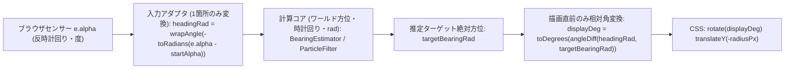

# RFID レーダー現行実装 ギャップ分析・不足仕様ドキュメント

> **参照元**
> - **現行実装（調査対象）**: ChatGPT 共有会話「コード解説 RSSI方角推定 (1)」（Keyence DX-W600 / Angular Web 向け RFID レーダー実装）
> - **参照プロジェクト（Angular 側）**: `radar-app/`（`superfind-core` から計算本質を抽出した Angular v13 / TypeScript 実装）
>   - `radar-app/src/app/radar/radar.models.ts`
>   - `radar-app/src/app/radar/radar-math.ts`
>   - `radar-app/src/app/radar/bearing-estimator.ts`
>   - `radar-app/src/app/radar/particle-filter.ts`
>   - `radar-app/src/app/radar/radar-tracker.service.ts`
>   - `radar-app/src/app/radar/radar.spec.ts`

---

## 1. 目的と位置づけ

本書は、現行の Angular 製 RFID レーダー実装（ChatGPT 会話ログより抽出した Keyence DX-W600 向け実装）と、本リポジトリ内の Angular 計算コア（`radar-app/`）を突き合わせ、**現行実装に不足しているアルゴリズム・アーキテクチャ・運用要件を明文化**したドキュメントである。

あわせて、最終章では **`radar-app/` のコアを現行の複数タグ・ブラウザ UI アプリへ実際に統合する際に追加で必要となるブリッジ設計**と段階的導入手順も整理する。

---

## 2. 不足項目サマリー（一覧マトリクス）

| # | 領域 | 現行実装の現状（ChatGPT ログより） | 不足している要素 | `radar-app` での参照先 | 優先度 |
|---|---|---|---|---|---|
| **1** | **方位推定アルゴリズム** | 24 セクター（15°刻み）の単純平均 RSSI 最大 1 セクター（`bestIndex * 15 + 7.5`）を離散選択 | 全体平均超過分による**円加重平均（連続補間）**と単独反射スパイク緩和 | `bearing-estimator.ts` (`estimate`) | **最高** |
| **2** | **方位の信頼度・不確実性** | `count` による簡易補正（`BASE_RSSI + confidence * (avg - BASE_RSSI)` 等）を模索中。負値乗算罠や未確定判定が未整理 | **3 要素の積**（`coverage × concentration × significance`）、2 セクター未満拒否、円標準偏差 `sigmaRad`、未探索セクター可視化 | `bearing-estimator.ts`, `radar.models.ts` (`BearingEstimate`) | **最高** |
| **3** | **座標系・角度管理** | `this.alpha`（左回り累積）、`this.angle`、`firstAlpha`、`firstAngle`、`bestAlpha`、`360 - bestAngle`、CSS `rotate()`（右回り）が混在し、符号反転・基準ズレ・`delta = 0` リセットバグが多発 | **単一ワールド座標系（北=0・時計回り・ラジアン）**への統一と、表示直前でのみ相対角変換する構造 | `radar-math.ts` (`wrapAngle`, `angleDiff`, `bearingBetween`), `radar.models.ts` (`UserPose`) | **最高** |
| **4** | **ノイズ除去・異常値除外** | セクター単純平均＋半径用 EMA（`smoothedRssi`）。単発反射スパイクに引きずられやすく、物理範囲外の異常値ゲートがない | 入口での **RSSI 物理妥当性チェック**（`RadioProfile`）＋時間窓 **中央値フィルタ**（`medianOfBestPriority`） | `radar-tracker.service.ts`, `radar-math.ts` (`median`), `radar.models.ts` (`RFID_UHF_PROFILE`) | **高** |
| **5** | **鮮度・トレンド・近接知覚** | 未受信 3 秒経過と極弱 RSSI を同じく「外周へ移動＋フェードアウト」で処理。接近トレンドや音・振動の設計がない | **「無信号 (`isFresh=false`)」と「遠距離」の厳密分離**、トレンド判定（`warmer/colder/steady`）、幾何補間の**ガイガーカウンター指標** | `radar-tracker.service.ts` (`computeTrend`, `computeProximityCue`) | **高** |
| **6** | **距離モデル・現場校正** | 線形 Min-Max 正規化 `(S - min) / (max - min)` を直接 px 半径へ変換。物理距離・UHF 往復減衰・環境差を扱えない | **対数距離パスロスモデル**（UHF 往復減衰 $n \approx 3.6$）、dB 空間対数尤度、**最小二乗キャリブレーション＋品質/妥当性ゲート** | `radar-math.ts` (`expectedRssi`, `estimateDistance`, `rssiLogLikelihood`, `fitPathLoss`, `pathLossResidualRms`, `isPathLossPlausible`) | **中〜高** |
| **7** | **2D 位置推定・不確実性領域** | その場回転の方位＋単発 RSSI 半径のみ。移動による絞り込み・複数固定リーダー融合・不確実性の面表示・発散検知がない | **2D パーティクルフィルタ**、自己移動（デッドレコニング）、**95% 信頼楕円**、複数固定リーダー融合（`observeFrom`）、**発散検知 (`diverged`)** | `particle-filter.ts`, `radar-math.ts` (`covarianceToEllipse`), `radar-tracker.service.ts` (`step`, `observeFrom`) | **中** |
| **8** | **状態管理・検証基盤** | コンポーネント内のミュータブル状態＋`setInterval`＋受信コールバックが密結合。数学的自動テストなし | UI 非依存サービス＋**不変 `RadarSnapshot` / RxJS `snapshot$`** 配信、決定的 PRNG（`SeededRng`）による単体テスト | `radar-tracker.service.ts`, `radar-math.ts` (`SeededRng`), `radar.spec.ts` | **高** |

---

## 3. 現行実装の現状整理（ChatGPT ログからの抽出）

ChatGPT の全 465 ターンから読み取れる現行実装の構成と、現場で直面していた本質的な課題を以下に整理する。

### 3.1 現行実装の構成

- **ターゲット環境**: Keyence DX-W600（UHF RFID ハンディリーダー）上の Angular Web アプリ
- **センサー入力**: `DeviceOrientationEvent` の `e.alpha`（0〜360°、開始時 269.5° 等の絶対角、左回り増加）
  - 読み取り開始時に `prevAlpha = currentAlpha`, `this.alpha = 0` とし、`diff = ((e.alpha - prevAlpha + 540) % 360) - 180` を累積
  - 加速度計・`beta`（前後傾き）は優先度と負荷を考慮し未採用
- **方角推定**:
  - タグ ID ごとに 24 セクター（15° 刻み）の `{ sumRssi, count }` を保持
  - 受信ごとに `recordRssi()` で加算し、1 秒ごと（または 100〜200 ms ごと）に `getStrongestAngle()` で平均 RSSI 最大の `bestIndex` を選択し、`bestIndex * 15 + 7.5` を算出
  - 各ドットに `firstAlpha` / `firstAngle` / `bestAlpha` を持ち、`delta = this.alpha - dot.firstAlpha`, `dot.angle = ((dot.firstAngle - delta) % 360 + 360) % 360` で画面回転に追従
- **距離表現・表示制御**:
  - RSSI を EMA（`smoothing = 0.2`）で平滑化し、線形正規化 `(rssi - min) / (max - min)` から `translateY(-radius)` の px 半径に変換
  - 最終受信時刻 `lastReadAt` から 3 秒未受信で、最後の角度を維持したまま 1 秒かけて外周半径へ移動・`opacity: 1 → 0` でフェードアウト
  - `.dot-orbit` の `transition: transform` は 360° 境界で逆回転を起こすため廃止し、`opacity` / `box-shadow` の `@keyframes soft-pulse` 点滅＋ラベル逆回転 `rotate(-angle)` で表現

### 3.2 現行実装で顕在化していた根本ボトルネック

1. **基準角度と符号の二重・三重管理**: 「端末の回転量（左回り）」「セクター角度」「ドット初期角」「CSS `rotate()`（右回り）」が同一コンポーネント内で混在し、`bestIndex` 更新時に `firstAlpha` を書き換えて `delta = 0` に戻る・ドットが逃げる・左右反転する問題が繰り返し発生していた。
2. **反射波・少数サンプルによる誤方位確定**: 単純平均 RSSI の最大 1 セクターを選ぶため、反射波や 1〜2 回だけ強く読めた別方向（例：実方向 90° に対し 120°）に容易に引きずられていた。負値 dBm に信頼度係数を掛けると逆に強くなってしまう問題にも直面していた。
3. **「推定」と「UI 表示」の未分離**: 角度・半径・EMA・フェードアウト・集計がドットオブジェクト上に直結しており、推定の確からしさ（信頼度・未探索範囲・発散）を扱えなかった。

---

## 4. 不足している機能・アルゴリズムの詳細仕様（`radar-app/` 対照）

以下、現行実装に不足している 8 項目を、`radar-app/` の実装と数学的根拠に紐づけて明文化する。

---

### 4.1 超過信号による円加重平均方位推定（単一最大セクター選択の置き換え）

#### 現行実装の不足点
- `getStrongestAngle()` が `average > bestAverage` となる**単一セクターの中心角**（`bestIndex * 15 + 7.5`）のみを返す。
- 結果として、① 推定方位が 15° 単位で飛びカクつく、② 2 セクター境界付近のタグで左右にチャタリングする、③ 単独セクターの突出スパイクを平滑化できない。

#### `radar-app` の参照実装（`radar-app/src/app/radar/bearing-estimator.ts` L107-L150）
観測済みセクター集合 $\mathcal{F}$、各セクター平均 RSSI $\mu_k$、全体平均 $\bar{\mu} = \frac{1}{|\mathcal{F}|}\sum_{k \in \mathcal{F}} \mu_k$ を用いて、**全体平均を上回る超過量（常に非負）** で円統計の加重平均を算出する。

$$
e_k = \max(\mu_k - \bar{\mu},\ 0)
$$

$$
S = \sum_{k \in \mathcal{F}} e_k \sin\theta_k, \qquad
C = \sum_{k \in \mathcal{F}} e_k \cos\theta_k, \qquad
\hat{\theta} = \operatorname{wrap}_{(-\pi, \pi]}\!\bigl(\operatorname{atan2}(S, C)\bigr)
$$

#### 現行実装に対する改善効果
- **滑らかな連続補間**: 隣接する強いセクター群の重心方向が連続値で得られ、セクター境界での飛びやチャタリングを抑えられる。
- **360° 境界の完全解消**: $\sin / \cos$ のベクトル和で合成するため、359° と 1° の平均が 180° に破綻する問題が起きない。
- **負値 RSSI の符号罠を回避**: 超過量 $e_k \ge 0$ は非負の重みになるため、現行実装で問題視していた「負の dBm に重みを掛けると 0 に近づいて強く誤認される」現象が構造的に発生しない。

---

### 4.2 3 要素の積による方位信頼度・未確定ゲート・角度不確実性

#### 現行実装の不足点
- 現行実装では `count`（観測回数）を信頼度として使う際、`BASE_RSSI + confidence * (avgRssi - BASE_RSSI)` や `rssiScore + confidence * COUNT_WEIGHT` といった調整定数依存の式を検討していたが、以下を評価できていない。
  1. **スキャン網羅率（カバレッジ）**: 狭い角度範囲しか回していないのに強い方向を確定してしまう。
  2. **方向集中度（単峰性）**: 全方位均一、あるいは正反対の 2 方向（反射＋直接波）にピークが割れている状態を判別できない。
  3. **統計的有意性（S/N 比）**: ピークと全体平均の差が電波ノイズの揺らぎ範囲内なのに方向を確定してしまう。
  4. **未探索方向のフィードバック**: どの方向をまだスキャンしていないか UI へ伝えられない。

#### `radar-app` の参照実装（`radar-app/src/app/radar/bearing-estimator.ts` L115-L178, `radar.models.ts` L146-L159）
1. **最小比較条件**: 観測済みセクター数 $|\mathcal{F}| < 2$ のときは必ず `null` を返す（比較対象なしに方位を断定しない）。
2. **3 要素の積による総合信頼度 (`confidence`)**:
   - カバレッジ:
     $$
     c_{\text{cov}} = \frac{|\mathcal{F}|}{K}
     $$
   - 集中度（円統計の合成ベクトル長 / Resultant length）:
     $$
     R = \operatorname{clamp}_{[0, 1]}\!\left(\frac{\sqrt{S^2 + C^2}}{W}\right), \qquad W = \sum_{k \in \mathcal{F}} e_k
     $$
   - 統計的有意性（ピーク超過量 $\Delta = \max \mu_k - \bar{\mu}$ と標準誤差 $\text{SE} = \sigma_{\text{noise}} / \sqrt{\bar{m}}$ の比、$\bar{m} = \max(N_{\text{total}} / |\mathcal{F}|, 1)$）:
     $$
     c_{\text{sig}} = \operatorname{clamp}_{[0, 1]}\!\left(\frac{\Delta}{2\,\text{SE}}\right)
     $$
   - 総合信頼度（**平均ではなく積**にすることで、どれか 1 つでも 0 に近ければ誤矢印を抑止する）:
     $$
     \text{confidence} = c_{\text{cov}} \cdot R \cdot c_{\text{sig}}
     $$
3. **角度不確実性 (`sigmaRad`)**: 半セクター幅を下限とし、分解能以上の精度を誇張しない。
   $$
   \sigma_\theta = \max\!\left(\sqrt{-2\ln\!\bigl(\operatorname{clamp}_{[10^{-6}, 1]}(R)\bigr)},\ \frac{\pi}{K}\right)
   $$
4. **未探索セクター配列 (`sectorMeans: (number | null)[]`)**: 未観測セクターを `null` として出力し、レーダー外周の未探索ギャップを可視化できる。

#### 導入指針
- `confidence < 0.30`（目安）の段階では方位矢印／確定ドット表示を控え、「周囲をゆっくりスキャンしてください（未探索ギャップあり）」と案内する設計にする。
- 現行の `SECTOR_COUNT = 24`（15°刻み）でも `radar-app` のデフォルト `16`（22.5°刻み）でも `TrackerConfig.bearingSectors` としてそのまま設定可能。ただし UHF RFID のハンディ指向性アンテナ（ビーム幅 60〜120°）では 16 分割の方が 1 セクターあたりのサンプル数 $\bar{m}$ が貯まりやすく、統計的有意性が安定しやすい。

---

### 4.3 単一ワールド座標系への統一と「計算角／表示角」の完全分離

#### 現行実装の不足点
- 現行実装では以下の角度概念が混在していた。
  - `e.alpha`（ブラウザ生値、左回り正、開始時任意オフセット）
  - `this.alpha`（左回り累積角）
  - `this.angle`（0〜360° 正規化角）
  - `dot.firstAlpha` / `dot.firstAngle` / `bestAlpha` / `bestAngle`
  - CSS `rotate()`（右回り正）
- そのため、`firstAngle - (this.alpha - firstAlpha)` と `360 - bestAngle`、さらに `bestIndex` 更新時の `firstAlpha` 再代入が絡み合い、**「定期的に `delta = 0` に戻る」「端末回転にドットがついてくる」「左右反転する」** 不具合が頻発していた。

#### `radar-app` の参照実装（`radar-app/src/app/radar/radar-math.ts` L20-L77, `radar.models.ts` L15-L26）
- **単一座標系ルール**: 計算コア内部はすべて **ENU 平面（$+x=$東、$+y=$北）** および **コンパス方位（北 $= 0$、時計回り正、ラジアン）** に統一する。
- **純粋関数への閉じ込め**: `toRadians`, `toDegrees`, `wrapAngle`（`(-π, π]`）, `wrapPositive`（`[0, 2π)`）, `angleDiff`, `bearingBetween`, `offsetPoint` を `radar-math.ts` に集約し、コンポーネント側に `% 360` や `+540` の手書き計算を散在させない。

#### 現行実装に対する改善効果
- `firstAlpha` / `firstAngle` / `bestAlpha` という**壊れやすい基準ペア管理そのものを廃止できる**。
- ターゲットの推定方位は常にワールド座標の 1 値 `targetBearingRad` で保持し、画面描画の瞬間だけ端末現在方位 `headingRad` との差 `angleDiff(headingRad, targetBearingRad)` を取れば、端末を何周回しても、いつ推定方位が更新されても、**座標ズレ・`delta = 0` リセット・符号反転が原理的に起きない**。

---

### 4.4 入口での異常値除外と中央値フィルタによる反射スパイク除去

#### 現行実装の不足点
- **スパイク耐性不足**: 半径表示に EMA（`smoothedRssi`）、方角集計に単純平均を使用しているため、マルチパス反射による単発の強スパイク（例：`-70 dBm` 連続中に混ざる `-20 dBm`）が推定値を大きく引きずる。
- **異常値バリデーション欠如**: リーダー SDK 由来の欠損値・異常値（例：`-127 dBm`、`0` 超、`NaN`）を入口で一律棄却する仕組みがない。
- **ソース品質差の未考慮**: 将来、異なる品質・頻度の観測ソースが混在した際に、低品質・高頻度ソースが高品質ソースを押し潰すリスクがある。

#### `radar-app` の参照実装（`radar-app/src/app/radar/radar-tracker.service.ts` L192-L194, L286-L292, L334-L356, `radar.models.ts` L47-L90）
1. **無線プロファイルによる異常値除外 (`isPlausibleRssi`)**:
   - `RFID_UHF_PROFILE` では `minRssiDbm = -95.0`, `maxRssiDbm = -15.0` を定義し、範囲外および非有限値（`!Number.isFinite`）を入口で即座に破棄（履歴・セクター・フィルタのいずれにも入れない）。
2. **高優先度ソース優先＋中央値フィルタ (`medianOfBestPriority`)**:
   - 直近時間窓（`liveWindowSec = 4.0 s`）内のサンプルから最高優先度（`priority` 最小）のソースのみを抽出し、その**中央値 (`median`)** を代表 RSSI に採用する。
   - 単発の反射スパイク（`-20 dBm` 等）を完全に無視できる。

---

### 4.5 「無信号（鮮度切れ）」と「遠距離」の分離・トレンド判定・近接フィードバック

#### 現行実装の不足点
- **無信号と遠距離の混同**: ChatGPT ログ（Turns 312–313, 346–355）では `elapsed >= 3000 || tag.rssi <= WEAK_RSSI_THRESHOLD` のように「3 秒未受信」と「電波が極端に弱い」を同一の外周表示・フェードアウトへ寄せており、ユーザーが「遠いが捕捉できている」のか「完全にロストした」のか判別しにくい。
- **接近／離反トレンドの欠如**: 歩行中にタグへ近づいているのか遠ざかっているのかの時系列比較指標がない。
- **視線フリー探索（音・振動）の欠如**: 倉庫や棚の間で現物を探す際、画面を見続けずに距離感を把握できるガイガーカウンター風の近接フィードバック仕様がない。

#### `radar-app` の参照実装（`radar-app/src/app/radar/radar-tracker.service.ts` L236-L271, L359-L433, `radar.models.ts` L181-L195）
1. **鮮度 (`isFresh`, `ageSec`) の厳密管理**:
   - 最終観測からの経過時間 `ageSec < profile.freshnessSec`（RFID デフォルト `5.0 s`）で `isFresh` を判定。
   - **「無音＝無信号」であり「無音＝遠い」にしない**: `proximityCue` が `null` になるのは `isFresh === false` のときのみ。遠距離で弱くても捕捉中であれば遅いクリックを返し続ける。
2. **トレンド判定 (`computeTrend`)**:
   - 直近窓（`0 〜 4 s`）と過去窓（`4 〜 12 s`）の中央値（各 2 サンプル以上）を比較し、差が `+3.0 dB` 超なら `warmer`、`-3.0 dB` 未満なら `colder`、それ以外は `steady`（サンプル不足時は `unknown`）。
3. **近接区分 (`ProximityBand`) と幾何補間ガイガーカウンター指標 (`ProximityCue`)**:
   - `nearDbm`（`-35 dBm`）〜 `farDbm`（`-80 dBm`）で強度 $t \in [0, 1]$ へ正規化。
   - 人間の対数知覚に合わせて**幾何補間**でクリック間隔・音程を決定（最速 `70 ms` で連続音化を防止）。
   $$
   \text{intervalMs} = 1400 \cdot \left(\frac{70}{1400}\right)^t, \qquad
   \text{pitchHz} = 440 \cdot \left(\frac{1320}{440}\right)^t
   $$

---

### 4.6 対数距離パスロスモデル（UHF 往復減衰）と最小二乗キャリブレーション

#### 現行実装の不足点
- 現行実装の距離表現は `(rssi - min) / (max - min)` の線形変換で画面半径 px を決めているだけであり、**物理距離 [m] の推定モデルを持たない**。
- パッシブ UHF RFID（920 MHz 帯）は「リーダー → タグ → リーダー」の往復減衰（バックスキャッタ）のため、自由空間や BLE より距離減衰が急（$n \approx 3.6$）であり、さらにタグ種別・貼付素材（金属/ダンボール/液体）・リーダー送信出力によって 1 m 基準 RSSI が 15 dB 以上変動する。これを校正・検証する仕組みがない。

#### `radar-app` の参照実装（`radar-app/src/app/radar/radar-math.ts` L83-L196, `radar.models.ts` L35-L90）
1. **対数距離パスロスモデル (`expectedRssi` / `estimateDistance`)**:
   $$
   \hat{r}(d) = P_{1\text{m}} - 10\,n\,\log_{10}\!\bigl(\max(d,\ 0.25)\bigr), \qquad
   \hat{d}(r) = \max\!\left(10^{\frac{P_{1\text{m}} - r}{10\,n}},\ 0.25\right)
   $$
   - `RFID_UHF_PROFILE` のプリセット: `txPower1m = -50.0 dBm`, `exponent = 3.6`, `defaultSigmaDb = 5.0 dB`。
2. **dB 空間での対数尤度 (`rssiLogLikelihood`)**:
   - シャドーイング誤差は距離空間ではなく dB 空間で正規分布するため、推定計算には必ず dB 空間尤度を使う（メートル変換後のガウス誤差は近距離バイアスを生む）。
3. **実測キャリブレーションと品質ゲート (`fitPathLoss`, `pathLossResidualRms`, `isPathLossPlausible`)**:
   - 等比間隔（例：1 m, 2 m, 4 m）の実測データから最小二乗回帰で $(P_{1\text{m}}, n)$ を自動推定。
   - **過学習防止ゲート**: 物理範囲外（`txPower1m ∉ [-100, -15]` または `exponent ∉ [1.5, 6.0]`）や RMS 残差 **8 dB 超** の異常フィットは自動棄却し、デフォルト値へ戻す。

---

### 4.7 2D パーティクルフィルタによる位置推定・95% 信頼楕円・複数リーダー融合・発散検知

#### 現行実装の不足点
- 現行実装は「その場での回転（方位）」と「単発 RSSI による半径」しか持たないため、以下の能力が欠落している。
  1. **移動による位置絞り込み**: ユーザーが歩いて（特に L 字／ドッグレッグ移動で）複数地点から観測した情報を幾何学的に統合できない。
  2. **不確実性の表現**: 1 地点からの観測は本来「円環（リング）」、直線歩行は「左右対称の双峰（鏡像曖昧性）」であるにもかかわらず、常に 1 点のドットとして表示してしまう。
  3. **複数固定リーダー連携**: 倉庫・店舗の固定 RFID アンテナ（既知座標）からの読取を統合して三辺測量する仕組みがない。
  4. **発散検知**: 金属棚による強反射やリーダー出力変更などで推定モデルと現実が破綻しても検知できない。

#### `radar-app` の参照実装（`radar-app/src/app/radar/particle-filter.ts`, `radar-math.ts` L202-L234, `radar-tracker.service.ts` L157-L224）
- **2D パーティクルフィルタ (`ParticleFilter`)**:
  - $N = 512$（ブラウザ軽量設定、高精度時は 1024〜2048）の粒子と対数重み `logWeights` でリング・双峰分布をそのまま表現。
  - **log-sum-exp 正規化**: 数千回更新してもアンダーフローしない。
  - **初回観測の円環サンプリング (`proposeFromRssi`)**: 初回から有効粒子を確保。
  - **Systematic Resampling + Roughening（0.15 m ジッター）+ Rejuvenation（ESS < 5% で 30% 再注入）**: 粒子退化を防止しつつ環境変化への回復力を維持。
  - **発散検知 (`diverged`)**: 最良粒子でも $6\sigma$ 超の残差が 8 回連続した場合、または重み総和が非有限になった場合に `diverged = true` を立て、リセットを促す。
- **95% 信頼楕円 (`covarianceToEllipse`)**:
  - 2×2 共分散行列の固有値分解と $\chi^2_{2, 0.95} \approx 5.99146$ から長半径・短半径・長軸方位を算出し、点ではなく不確実性領域を出力。位置信頼度 $\text{confidence} = \frac{1}{1 + a / \max(d, 1.0)}$ も併せて返す。
- **デッドレコニング (`step`, `resetUserPosition`) と複数固定リーダー融合 (`observeFrom`)**:
  - `observeFrom(obs, readerPosition, false)` により、自端末の RSSI 表示や方位セクターを汚さずに他リーダー観測を 2D 位置推定へ融合可能。

---

### 4.8 不変スナップショットアーキテクチャと決定的テスト基盤

#### 現行実装の不足点
- Angular コンポーネント内にセンサー受信・RSSI 集計・角度補正・タイマーフェードアウト・DOM バインディング用プロパティが混在し、可変状態を直接書き換えている。
- 数値表示・ドット角度・半径・（将来の）音フィードバックが別々のタイミングで更新され、表示間で矛盾が起きやすい。
- アルゴリズムの正当性（スパイク耐性・方位精度・360°境界・鏡像曖昧性・長時間安定性）を回帰検証するユニットテスト基盤がない。

#### `radar-app` の参照実装（`radar-app/src/app/radar/radar-tracker.service.ts` L75-L88, L236-L271, `radar-math.ts` L253-L279, `radar.spec.ts`）
- **不変 `RadarSnapshot`＋RxJS `snapshot$`**: 同一時刻の全計算値（`rssiDbm`, `isFresh`, `ageSec`, `crudeDistanceM`, `proximityBand`, `trend`, `proximityCue`, `fix`, `bearing`, `sectorMeans`, `userPose`, `diverged` 等）を 1 つの不変オブジェクトに集約し、UI はこの単一スナップショットのみを購読する。
- **決定的 PRNG (`SeededRng`) と 15 ケースの数学的単体テスト (`radar.spec.ts`)**: `Math.random()` を排除し、L 字歩行収束・直線歩行の鏡像曖昧性・スパイク除去・3 台固定リーダー三辺測量・長時間非アンダーフローを CI 上で再現可能に検証している。

---

## 5. `radar-app/` を現行アプリへ統合する際に補うべきブリッジ要件

`radar-app/` は「**単一ターゲットの計算コア**」に徹しているため、現行の Keyence DX-W600 向け Angular アプリ（複数タグ同時表示・ブラウザ UI）へ組み込む際には、逆に以下の 5 点をアダプタ／UI 層として補う必要がある。

| # | ブリッジ要件 | 現状のギャップ | 推奨設計 |
|---|---|---|---|
| **B1** | **複数タグ（EPC ごと）の同時管理** | `RadarTrackerService` は `@Injectable({ providedIn: 'root' })` の単一ターゲット前提。現行アプリは `Map<tagId, ...>` で複数タグを同時描画している。 | 1 タグ分の追跡ロジックを純粋クラス `RadarTracker` としてインスタンス化可能にし、上位に `MultiTagRadarService`（`Map<string, RadarTracker>`）を配置する。`UserPose`（自己位置・方位）のみ全タグで共有する。 |
| **B2** | **`DeviceOrientationEvent` アダプタ層** | `radar-app` はコンパス方位 `headingRad`（時計回り・rad）を前提とするが、ブラウザ `e.alpha` は端末依存オフセット（269.5° 等）かつ反時計回り増加。 | 開始ボタン押下時に `startAlpha = e.alpha` を記録し、入口 1 箇所だけで時計回りラジアンへ正規化（例：`headingRad = wrapAngle(-toRadians(e.alpha - startAlpha))`）して `setHeading()` へ流す。実機で回転方向を確認し符号を 1 箇所に固定する。 |
| **B3** | **セクターの時間窓／忘却・リセット戦略** | `BearingEstimator` は `clear()` するまで過去の全サンプルを累積平均し続ける。ユーザーが移動したり環境が変わったりすると古い方位が引きずられる（ChatGPT ログ Turns 155, 201–203, 439 でも課題視）。 | ① 一定移動距離（例：2 m 以上移動）で `bearing.clear()` を自動発火する、または ② `BearingEstimator` に指数減衰（忘却係数 $\gamma \in (0, 1)$）またはスライディング時間窓（直近 $T$ 秒）を導入する。 |
| **B4** | **レーダー UI コンポーネント実装** | `radar-app/src/app/app.component.ts` は `snapshot$` の JSON 表示のみ。 | ChatGPT ログで確立済みの UI 知見を統合する：① 相対角 `angleDiff(userPose.headingRad, bearingRad)` で `rotate()`、② ラベル逆回転 `rotate(-deg)`、③ `transition: transform` 禁止＋`@keyframes soft-pulse` 点滅、④ 100〜200 ms の描画スロットリング（集計は毎回・描画のみ間引き）、⑤ `isFresh === false` 時の「無信号」外周フェードアウト（遠距離と視覚的に区別）、⑥ `sectorMeans` の未探索ギャップ表示と `fix.ellipse` の 95% 信頼楕円描画。 |
| **B5** | **UHF RFID 実機運用ガード** | リーダー SDK の仕様差・物理現象への実運用対策。 | ① **キャッシュ重複投入の禁止**（新規読取イベントのみ `observe()` を呼ぶ。重複投入はパーティクルフィルタの過信を招く）、② **送信出力（Tx Power）変更時の補正**（出力を下げたら `txPower1m` をオフセットするか `reset()`）、③ **歩数センサー非搭載時のモード切替**（ハンディ機単体で歩数が取れない場合は「その場回転＝`BearingEstimator` 主体」、固定リーダー併用時は `observeFrom` 主体で運用）。 |

---

## 6. 現行アプリへの段階的導入ロードマップ

現行の Keyence DX-W600 アプリを止めずに安全に置き換えるための推奨順序は以下の通り。

1. **Phase 1：座標系と方位推定の置き換え（最優先・即効性大）**
   - `radar-math.ts` と `bearing-estimator.ts` を取り込む。
   - `DeviceOrientationEvent` 入口アダプタで `headingRad`（時計回り・rad）へ統一し、現行の `firstAlpha` / `firstAngle` / `bestAlpha` 計算を撤去する。
   - `getStrongestAngle()` を `BearingEstimator.estimate()`（超過信号の円加重平均＋3 要素信頼度 `confidence`）へ置き換え、`sectorMeans` の未探索ギャップを UI に表示する。
2. **Phase 2：RSSI 前処理・鮮度・トレンド・近接フィードバックの導入**
   - `RadioProfile`（`RFID_UHF_PROFILE`）による入口バリデーションと `medianOfBestPriority`（中央値フィルタ）を導入し、反射スパイク耐性を確保する。
   - `isFresh` に基づいて「無信号」と「遠距離」を UI・音（`ProximityCue`）で明確に分離し、`trend`（`warmer` / `colder` / `steady`）を追加する。
3. **Phase 3：パスロス校正と複数タグ統合サービス化**
   - 現場タグを用いた `fitPathLoss()` / `pathLossResidualRms()` / `isPathLossPlausible()` の簡易キャリブレーション画面を追加し、線形 px 変換から物理距離ベースの表示へ移行する。
   - `RadarTracker` をタグ ID ごとに管理する `MultiTagRadarService` と、不変スナップショット購読（100〜200 ms スロットリング）へ整理する。
4. **Phase 4：2D パーティクルフィルタ・信頼楕円・複数リーダー融合の展開**
   - 歩行探索（歩数計／手動ステップ）または固定 RFID リーダー連携（`observeFrom`）が利用可能なシナリオで `ParticleFilter` と `ConfidenceEllipse`（95% 信頼楕円）・`diverged` 警告を有効化する。
